<p align="center">
  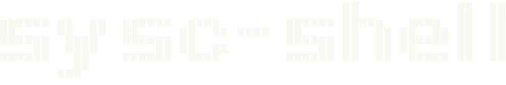
</p>


A desktop shell for Niri, written in Go. Bars, panels and OSDs, with separate daemons for
notifications, clipboard history and the system tray.

<details>
<summary>Video tour</summary>

https://github.com/user-attachments/assets/7cadf7b9-6fe5-4d53-b7d6-757e4082b68a

<p align="center"><sub>Settings, Bar settings and the system monitor opening over a static wallpaper, bar included. <a href="assets/tour.mp4">Download the 1080p file</a> (19 s).</sub></p>

</details>

## Quick Links

- [Documentation site](https://nomadcxx.github.io/sysc/docs/components/sysc-shell/)
- [Documentation](#documentation)
- [The sysc ecosystem](https://github.com/Nomadcxx/sysc-shell/blob/main/docs/ecosystem.md)

## Screenshots

Captured from fixture data with invented names, so nothing here is a real account, network or device. The wallpaper picker is the exception: it shows the author's own wallpaper library.

<table>
  <tr>
    <td align="center" valign="top">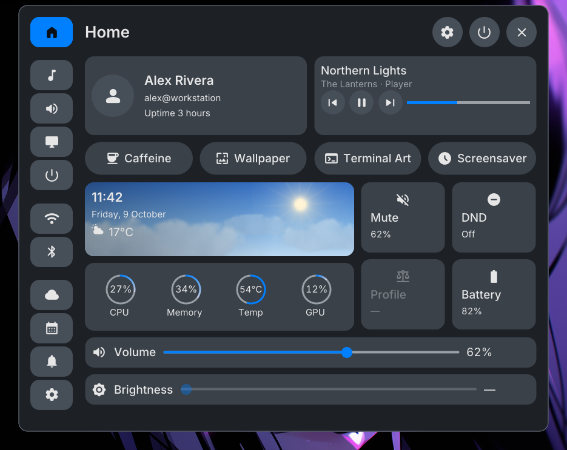<br><sub>Control centre: Home</sub></td>
    <td align="center" valign="top">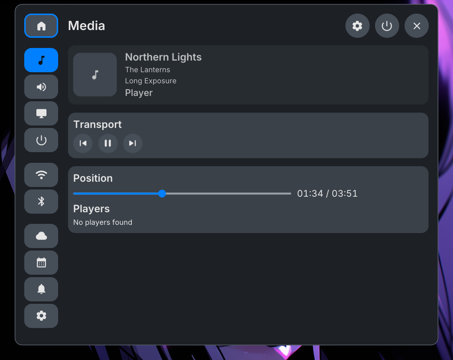<br><sub>Control centre: Media</sub></td>
  </tr>
  <tr>
    <td align="center" valign="top">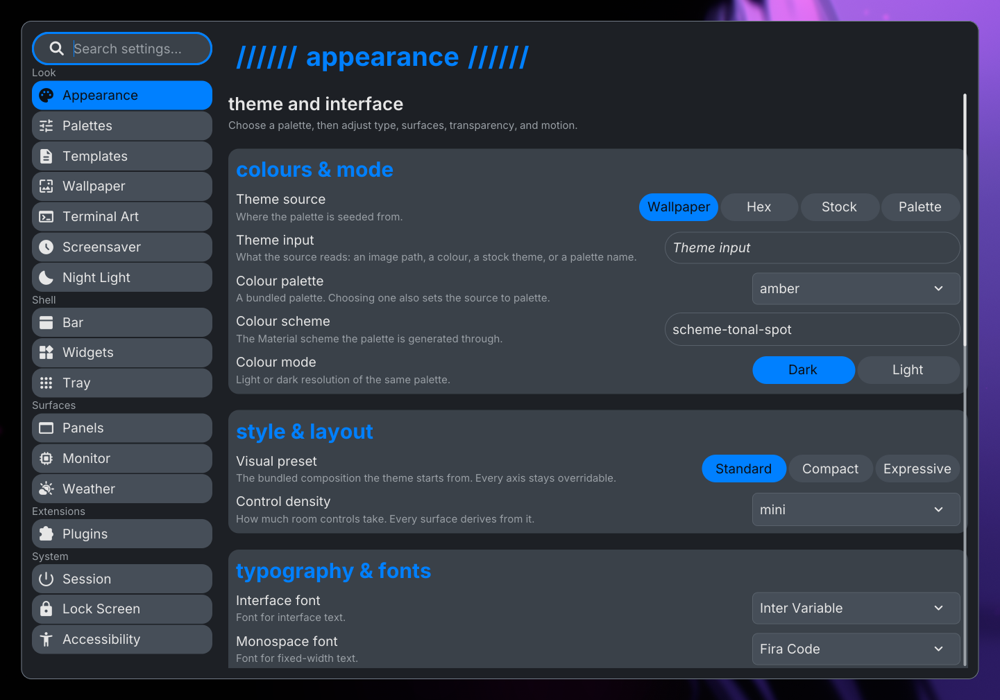<br><sub>Settings: Appearance</sub></td>
    <td align="center" valign="top">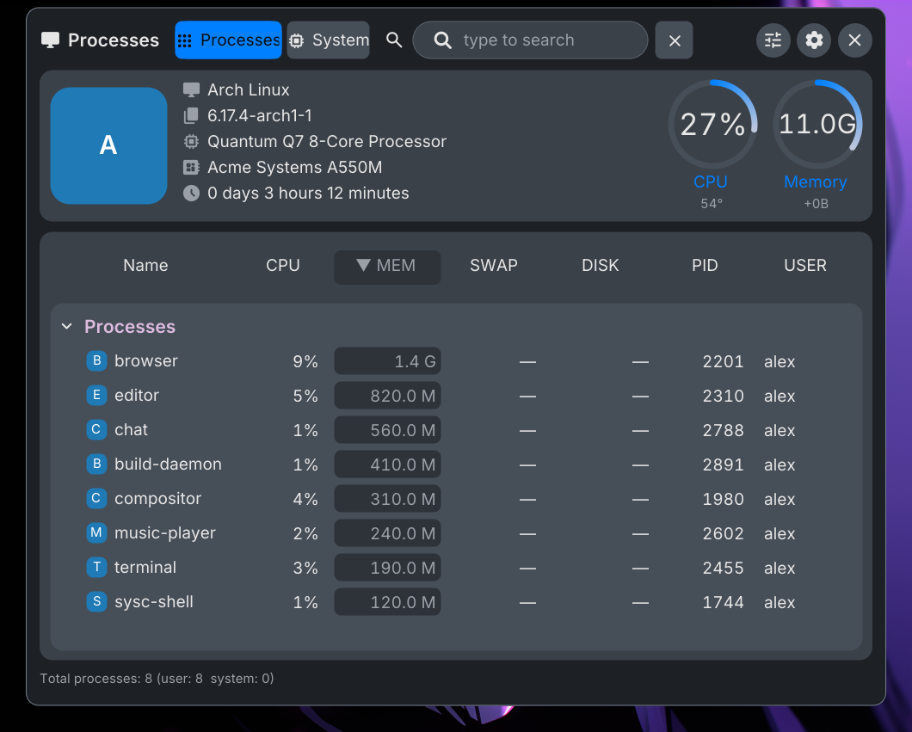<br><sub>System monitor</sub></td>
  </tr>
  <tr>
    <td align="center" valign="top">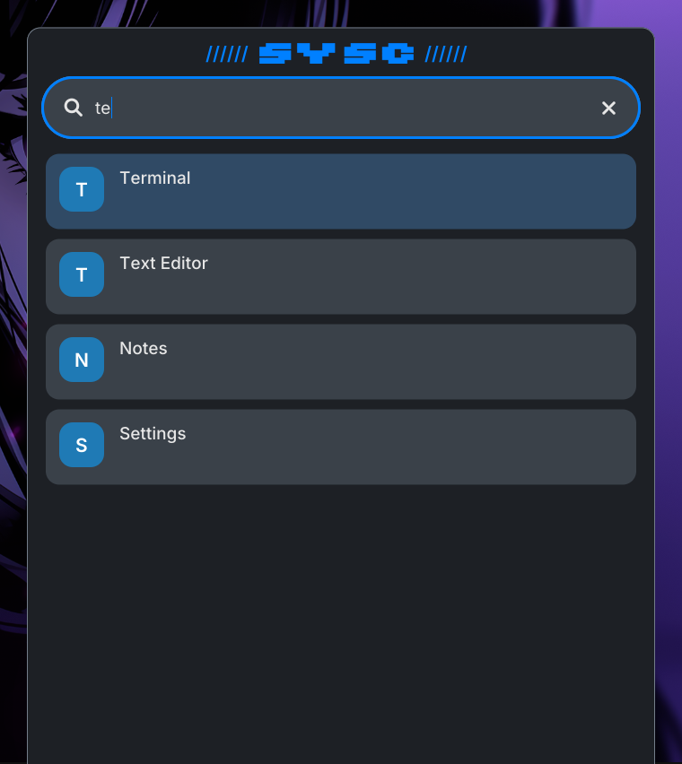<br><sub>Launcher</sub></td>
    <td align="center" valign="top">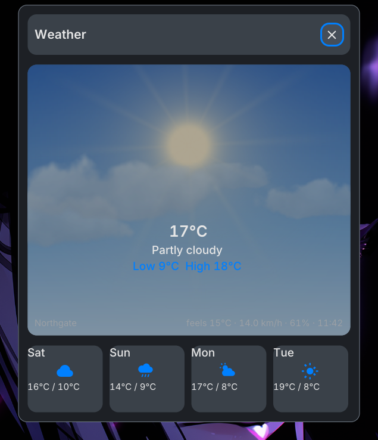<br><sub>Weather</sub></td>
  </tr>
  <tr>
    <td align="center" valign="top">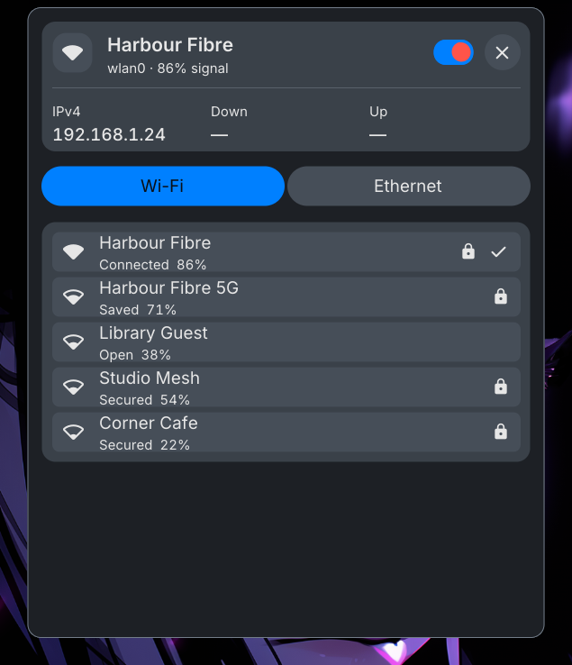<br><sub>Wi-Fi</sub></td>
    <td align="center" valign="top">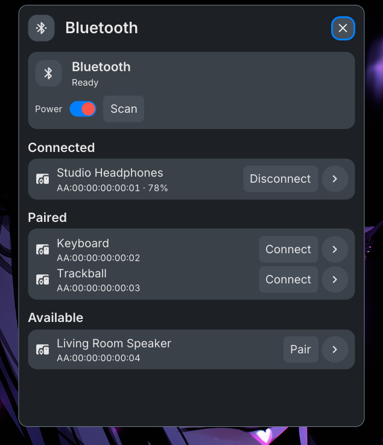<br><sub>Bluetooth</sub></td>
  </tr>
  <tr>
    <td align="center" valign="top">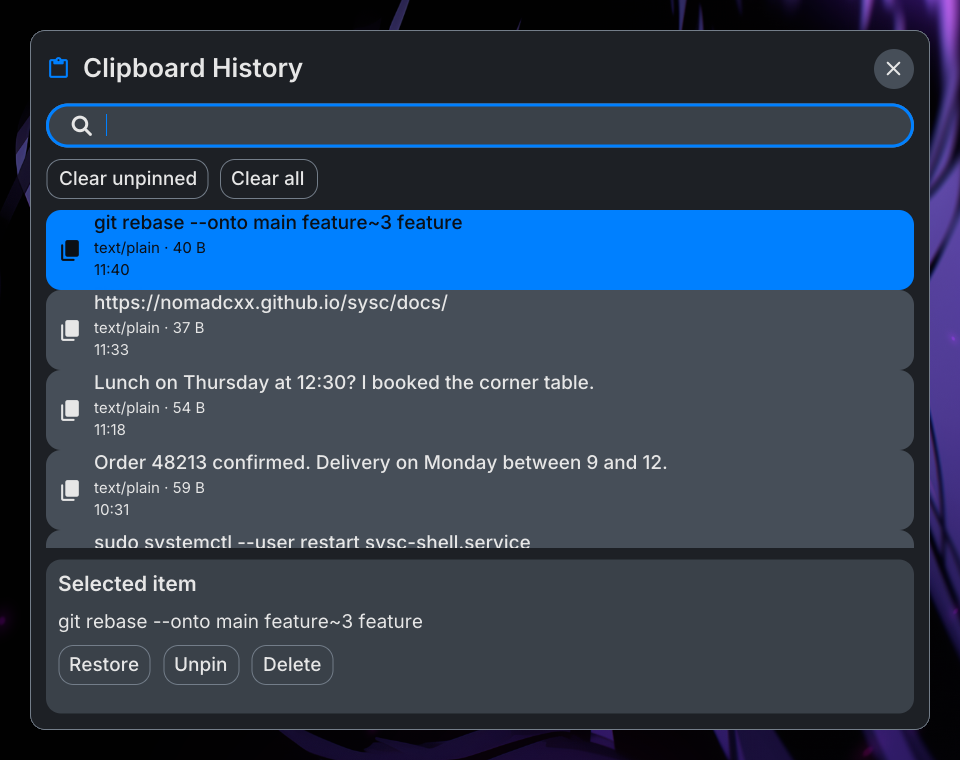<br><sub>Clipboard history</sub></td>
    <td align="center" valign="top">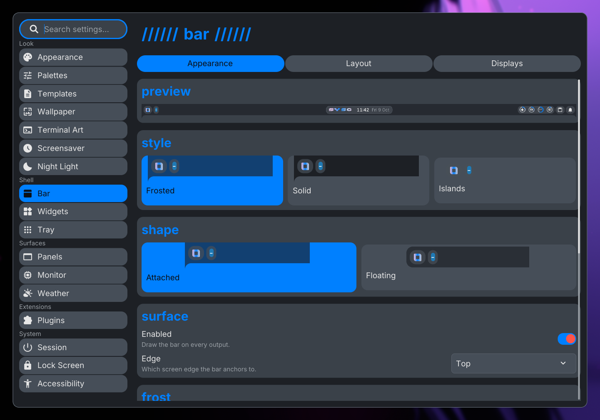<br><sub>Settings: Bar</sub></td>
  </tr>
  <tr>
    <td align="center" valign="top" colspan="2">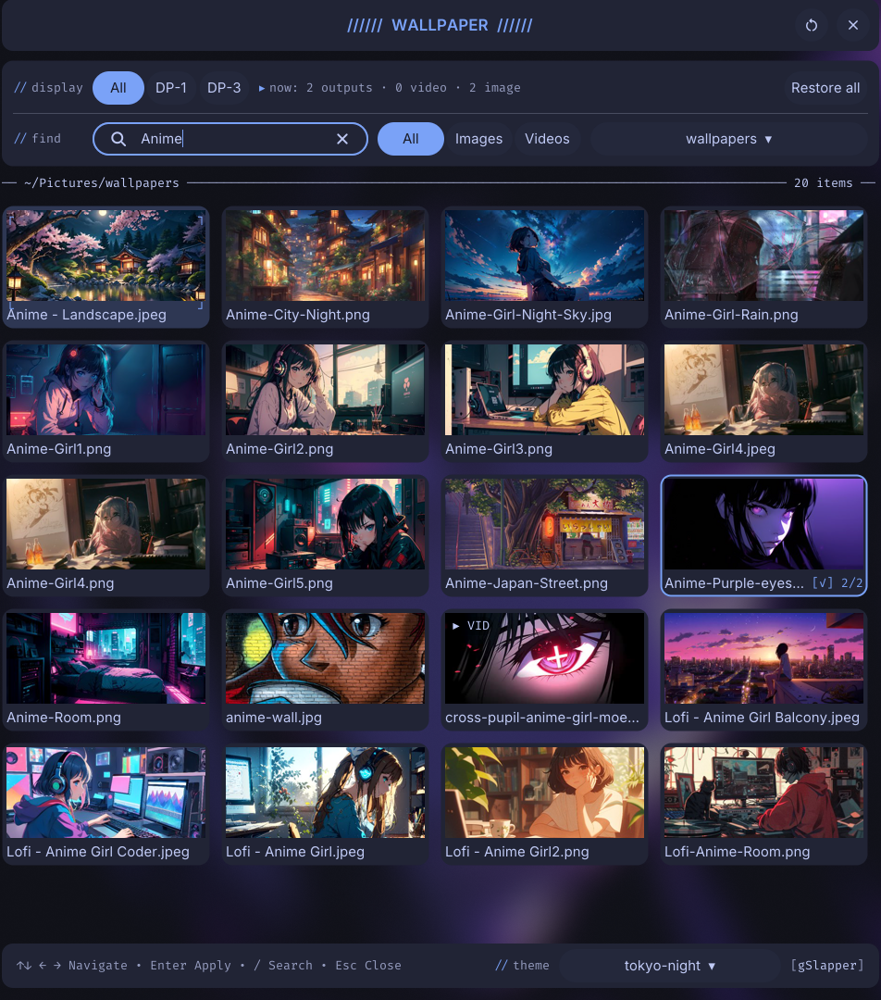<br><sub>Wallpaper picker</sub></td>
  </tr>
</table>

## Installation

### Requirements

Niri, started as a session (`niri-session`, which is what display managers run) so
systemd knows about your graphical session. Source builds need Go 1.26.4+.

Optional: `matugen` for wallpaper colours, `awww`, `swaybg` or `gSlapper` for wallpapers, and
`wl-clipboard`.

### Guided installer (recommended)

Use the [SYSC Go installer](https://github.com/Nomadcxx/sysc#install) to set up
the shell, its companions and your Niri session together.

### AUR

On Arch, install [sysc-shell](https://aur.archlinux.org/packages/sysc-shell) with
your AUR helper. Stop existing bars and notification daemons before starting the shell:

```sh
yay -S sysc-shell
systemctl --user enable --now sysc-shell.service
```

Run the service command inside a Niri session started with `niri-session`.
The package pulls in notifications, clipboard, tray and sysc-lock; its service
starts them before the shell. On first start, it creates a missing shell config
with sysc-lock selected and tray presentation enabled. Existing configs stay intact.
Install `sysc-terminal` for animated wallpaper and `sysc-plugins-git` for the
official plugin bundle.

[Documentation](https://nomadcxx.github.io/sysc/docs/).

### Nix

For Nix, the flake is the installation route: nothing here is packaged as an AUR package and the
guided installer does not touch a Nix store. home-manager users import the module and enable it:

```nix
{
  inputs.sysc-shell.url = "github:Nomadcxx/sysc-shell";

  # In a home-manager flake configuration:
  #   modules = [ inputs.sysc-shell.homeModules.default ];
  #   programs.sysc-shell.enable = true;
  #
  #   # Optional: the weather plugin, linked into the user plugin root
  #   # under its manifest id.
  #   programs.sysc-shell.plugins = [
  #     inputs.sysc-shell.packages.${pkgs.system}.sysc-shell-plugin-weather
  #   ];
  #
  # Without home-manager, on NixOS, where the package goes into
  # environment.systemPackages and the unit into /etc/systemd/user:
  #   imports = [ inputs.sysc-shell.nixosModules.default ];
  #   programs.sysc-shell.enable = true;
  #
  # Without the module, use the overlay and set the package yourself:
  #   nixpkgs.overlays = [ inputs.sysc-shell.overlays.default ];
  #   programs.sysc-shell.package = pkgs.sysc-shell;
}
```

The two modules reuse the repository's own `packaging/systemd/sysc-shell.service` with `ExecStart`
pointed at the store, so there is one unit and one install story. The home-manager module puts the
shell binary in your profile, which is what makes the `sysc-shell ipc` commands below work;
`nixosModules.default` is the machine-wide counterpart for a system without home-manager: the
package in `environment.systemPackages` and the same unit under `/etc/systemd/user`, which every
user's service manager reads. Plugin directories and shell settings are per user, so those stay
with the home-manager module. No release is tagged yet, so `sysc-shell --version` reports
`development (<source revision>)`. Nothing seeds or rewrites `config.json`, and `scripts/deploy`
does not apply: a Nix install starts a store path, not the binary under `~/.local/bin`. Enabling
refuses to activate while `~/.local/bin/sysc-shell` exists, because two shells would fight over
the bar.

Not covered, on purpose: no CI workflow builds the flake, no companion daemon is packaged, and
the deploy-guard drop-in is not installed.

### Build from source

```bash
git clone https://github.com/Nomadcxx/sysc-shell
cd sysc-shell
go build -o ~/.local/bin/sysc-shell ./cmd/sysc-shell
```

### Source builds: user service

```bash
install -Dm644 packaging/systemd/sysc-shell.service ~/.config/systemd/user/sysc-shell.service
systemctl --user daemon-reload
systemctl --user enable --now sysc-shell.service
```

The service starts with your Niri session and restarts the shell if it crashes. If your Niri config
already has a `spawn-at-startup` line for sysc-shell, remove it, or you'll get two shells. More
detail in [packaging/systemd](packaging/systemd/README.md).

### Which build am I running?

```bash
sysc-shell --version
sysc-shell ipc status
```

Release binaries are stamped with their version and commit; the same two values appear as `version` in
`ipc status`. Builds from source and from your AUR helper are not stamped and report
`sysc-shell development (unknown)`. That is the honest answer, not a lookup failure: an unstamped
build has no version to report until the release workflow stamps it. A Nix build stamps the revision
it was cut from instead, `sysc-shell development (<source revision>)`. Use `sysc --version` from the
installer to see which suite an install actually recorded.

### Companion daemons

Notifications, the tray and clipboard history each run as their own small daemon, so a crash in one
doesn't take the bar with it. Their state survives a shell restart. The shell works without them;
you just don't get that feature.

- **Notifications** — [sysc-notify](https://github.com/Nomadcxx/sysc-notify#installation). Stop mako,
  dunst or swaync first.
- **Clipboard history** — [sysc-clipboard](https://github.com/Nomadcxx/sysc-clipboard#installation).
- **System tray** — [sysc-tray](https://github.com/Nomadcxx/sysc-tray) `v0.1.2`.
- **Session lock** — [sysc-lock](https://github.com/Nomadcxx/sysc-lock), then point the shell at it:

  ```json
  { "session": { "locker": "sysc-lock" } }
  ```

- **Idle screensaver** — [sysc-walls](https://github.com/Nomadcxx/sysc-walls). The shell discovers
  the installed `sysc-walls.service` and configures it from Settings.

### Plugins

```bash
git clone https://github.com/Nomadcxx/sysc-plugins
cd sysc-plugins
make install
```

Then enable them from the plugin manager. See [sysc-plugins](https://github.com/Nomadcxx/sysc-plugins)
for what each one needs.

## Usage

Everything opens from the bar. To open panels from the keyboard, bind `sysc-shell ipc` in your Niri
config:

```kdl
binds {
    Super+Space { spawn "sysc-shell" "ipc" "panel.toggle" "{\"panel\":\"launcher\"}"; }
    Super+X     { spawn "sysc-shell" "ipc" "panel.toggle" "{\"panel\":\"session\"}"; }
    Super+Comma { spawn "sysc-shell" "ipc" "panel.toggle" "{\"panel\":\"settings\"}"; }
    XF86AudioRaiseVolume allow-when-locked { spawn "sysc-shell" "ipc" "osd.step" "{\"kind\":\"audio\",\"action\":\"up\"}"; }
}
```

The panels you can name are `launcher`, `control-center`, `notifications`, `clipboard`, `clock`,
`weather`, `system-monitor`, `session`, `power`, `settings`, `wallpaper`, `audio`, `network`,
`bluetooth`, `files`, `onboarding`, `terminal-art` and `plugin-store`. `wallpaper` and `terminal-art` are opt-in. The full set of bindings,
including brightness and mute, is in [docs/niri-hotkeys.md](docs/niri-hotkeys.md).

From a terminal:

```bash
sysc-shell ipc status
sysc-shell ipc panel.toggle '{"panel":"control-center"}'
```

### Scripting the socket

The socket is `$XDG_RUNTIME_DIR/sysc-shell/ipc.v1.sock`, readable only by your user. Each request is
one JSON line, `{"id":…,"method":…,"params":{…}}`, and each reply is one line.

`ipc.capabilities` reports the protocol version (`api`, currently 2), every method the running shell
answers, the delegated method families, the topics you can subscribe to, and the limits below. A
method or topic it does not list is unsupported.

```bash
sysc-shell ipc ipc.capabilities
sysc-shell ipc subscribe panels --seconds 20
```

- **Replies.** The methods that existed before version 2 (`status`, `panel.*`, `osd.step`, …) keep
  their flat reply shape; that shape is frozen. Newer methods (`ipc.*`) reply
  `{"id":…,"ok":true,"result":{…}}`. Every error has an `error` message. Errors from the transport and
  from newer methods also carry a `code`: `unsupported`, `invalid_params`, `limit_exceeded`, `timeout`,
  `cancelled` or `busy`.
- **Subscriptions.** `ipc.subscribe {"topics":["panels"]}` turns its connection into an event
  connection, which then accepts only `ipc.subscribe` and `ipc.unsubscribe`; send commands on another
  connection. Each topic starts with a `snapshot` event, then sends `state` events carrying the whole
  new value with a rising `seq`. A reader that falls behind skips to the latest value, marked `resync`.
  An `error` event ends one topic. Closing the connection ends every subscription.
- **Topics.** `panels` is the sorted list of open panel ids.
- **Limits.** A request line holds at most 65536 bytes. The shell serves at most 32 event
  connections, 16 topics on each, and 2 MiB for one state. A reader that cannot take a write for five
  seconds is disconnected.

`sysc-shell ipc subscribe TOPIC... [--seconds N]` prints one event per line for N seconds (default
30, at most 300). It exits 0 when the time runs out or on Ctrl+C, and nonzero if a topic is refused
or ends.

Settings are in the settings panel and saved to `$XDG_CONFIG_HOME/sysc-shell/config.json`
(default: `~/.config/sysc-shell/config.json`). Logs go to
`journalctl --user -u sysc-shell`.

Add launcher commands under `launcher` in `config.json`:

```json
{
  "launcher": {
    "providers": [{
      "name": "Files",
      "prefix": "/files",
      "glyph": "glyph:description",
      "description": "Search files",
      "command": ["file-list", "--query={query}"],
      "on_select": ["file-open", "{selection}"]
    }],
    "actions": [{
      "id": "open-docs",
      "label": "Open documentation",
      "argv": ["browser", "https://example.test/docs"]
    }]
  }
}
```

The provider command prints one result per line as `label` or `label<TAB>comment`. Type `/files query`
to search it. `on_select` receives the full output line as `{selection}` and the search text as
`{query}`. The shell replaces templates inside argv elements and runs both commands without shell
evaluation. Fixed actions appear in launcher search; actions marked `"dangerous": true` stay hidden
until you also set `"allow_dangerous": true`.

### Checking the config file

```bash
sysc-shell config check
sysc-shell config check /path/to/config.json
```

`config check` answers whether the shell would accept a configuration file, without a compositor, a
Niri socket or a Wayland connection, so you can run it from a script or before restarting the shell.
The path defaults to `$XDG_CONFIG_HOME/sysc-shell/config.json`. An absent default file is reported as
ok with `(defaults, file not found)`: the shell starts with its built-in defaults, and that is the
answer. The exit codes are a contract: 0 accepted, 1 the loader rejected the content, 2 usage or a
read failure. On a rejection the loader's message goes to stderr, naming the problem.

## Panels and integrations

The shell draws through `wl_shm` and talks to Niri over its IPC socket.

- **Bars**: one per output, with workspaces, window title, clock, weather, CPU, memory, temperature,
  GPU, disk, network, battery and the system tray
- **Launcher**: fuzzy app search that learns what you open, desktop actions, a calculator and emoji
- **Control centre**: network, Bluetooth, audio, media players, weather and a calendar (via the calendar plugin) in one panel
- **Notifications**: popups and a history centre, fed by [sysc-notify](https://github.com/Nomadcxx/sysc-notify)
- **Clipboard**: browse, restore and pin history kept by [sysc-clipboard](https://github.com/Nomadcxx/sysc-clipboard)
- **Files**: a file browser panel with breadcrumb navigation, symlink-safe listing and moves across
  devices
- **System monitor**: live gauges, and a process view grouped by application
- **Session panel**: log out, suspend, reboot and power off, with battery status and power profiles
- **Session lock**: hands the screen to [sysc-lock](https://github.com/Nomadcxx/sysc-lock) and tracks
  it through the lock, including one respawn if it dies while locked. Run that lock screen as a user
  service (`sysc-lock --session`) so one owner holds the lock; the shell's Lock button then commands
  it, and sleep waits until it reports sealed. Lock Screen settings cover the clock style, static-art
  header choices with a live preview, and the effect backend and presentation keys
- **OSD**: volume and brightness
- **First-run setup**: a five-step onboarding panel for the desktop defaults, offered when no config
  exists and reopenable from the panel list
- **Languages**: the shell and Settings ship in English, Spanish, Portuguese, Japanese, Korean and
  Russian; pick one in Settings → Session → Language
- **Theming**: Material 3 colours from your wallpaper through matugen, applied to the shell and, with
  templates, to your other apps
- **Wallpaper**: set it from the shell with awww, swaybg or gSlapper, or paint live terminal effects
  with [sysc-terminal](https://github.com/Nomadcxx/sysc-terminal). Playback pauses by reason when an
  output is covered or a fullscreen window takes it
- **Idle screensaver**: [sysc-walls](https://github.com/Nomadcxx/sysc-walls), controlled from Settings
- **Frosted glass**: blurred bars and panels on Niri 26.04 and later
- **Plugins**: a plugin manager and store, with panel previews rendered through the shell's own
  pipeline. The official plugins live in [sysc-plugins](https://github.com/Nomadcxx/sysc-plugins)

## Ecosystem

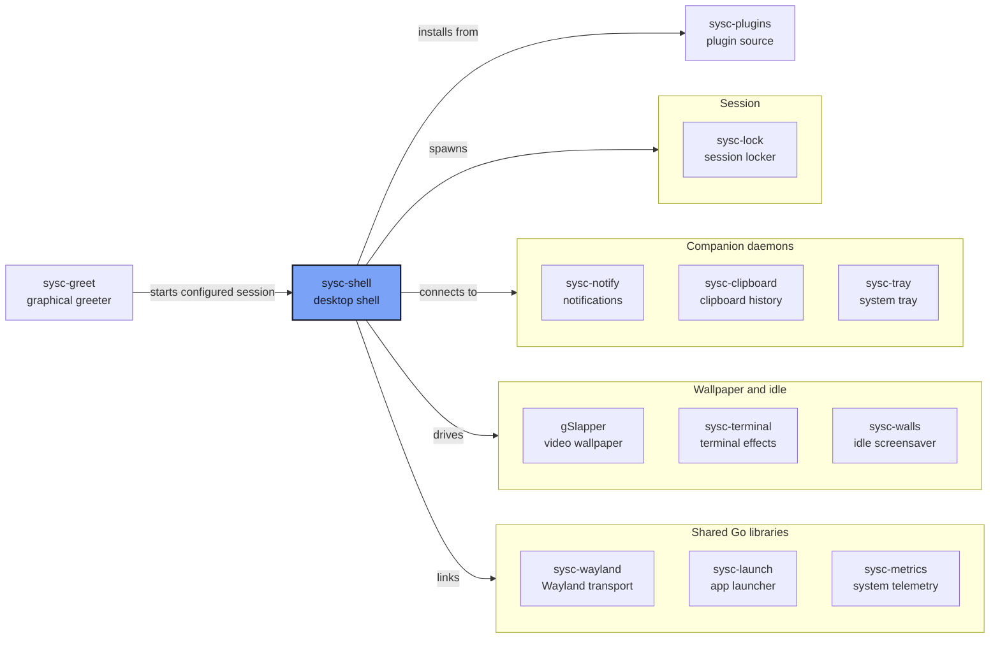

[The sysc ecosystem](docs/ecosystem.md) explains each connection, socket and version pin.

## Documentation

- [The sysc ecosystem](docs/ecosystem.md) — how the projects fit together
- [Niri hotkeys](docs/niri-hotkeys.md)
- [Blur on Niri](docs/niri-blur.md)
- [Night light](docs/night-light.md)
- [Metrics widgets and Intel GPU usage](docs/metrics-widgets.md)
- [PolicyKit authentication](docs/polkit-authentication.md)
- [Running under systemd](packaging/systemd/README.md)
- [Development](docs/development.md)

## License

BSD-3-Clause. [NOTICE](NOTICE) covers the app-theming template catalog.

---

<a href="https://github.com/Nomadcxx"></a> — terminal-native tooling for the linux desktop.
[More projects →](https://github.com/Nomadcxx) · [Sponsor](https://github.com/sponsors/Nomadcxx) ❤️

## Theme following in the greeter and locker

Named palette changes publish an atomic selection to `sysc-shell/shell-theme` under your XDG config directory. Sysc-lock follows this selection by default at the next lock; the Lock Screen settings switch or `"follow_shell": false` keeps its palette independent. Choosing a locker palette also disables following.

The account selected during sysc-greet installation also publishes to `/var/lib/sysc-greet/shell-theme/theme`, when the installer has assigned that directory to it. Sysc-greet follows the selection at its next start. Other accounts control their own lockers without changing the machine greeter.

Previews do not publish. Failed or superseded theme changes retain the previous selection. Wallpaper-generated, hex and custom palettes publish no named selection, so each consumer retains its configured fallback.

Terminal Art blur: Settings → Terminal Art → Blur strength sets the default for
new effect selections. 0 is off; 1–64 softens the wallpaper. Requires a
sysc-terminal build advertising blur support. Running effects retain their
applied strength until selected again.
